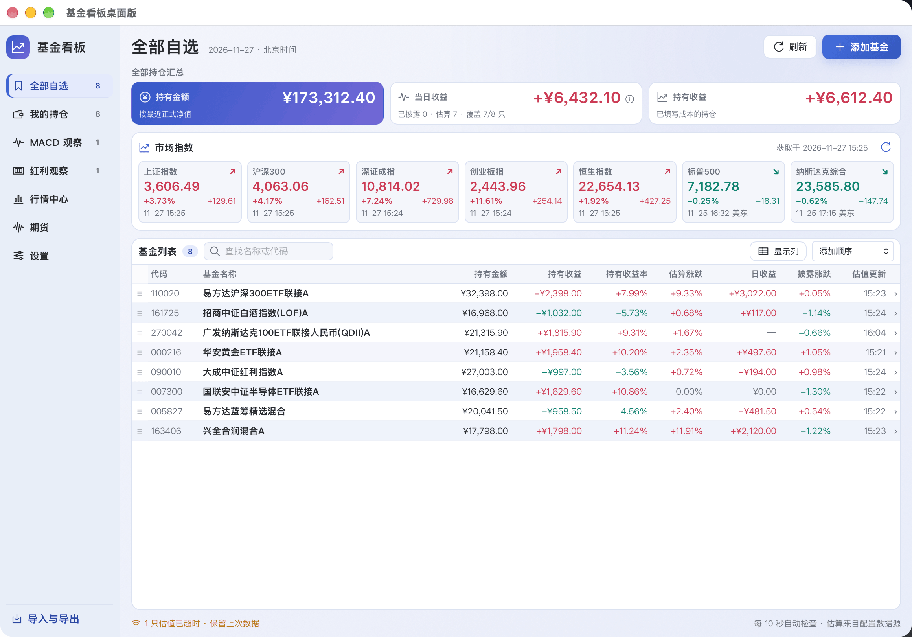

# FundDesk（基金看板）

Windows 10 / macOS 桌面版，Tauri 2 + Rust + React。英文名为 **FundDesk**，中文名为
「**基金看板**」，bundle identifier 为 `app.funddesk.desktop`，可在 Swift 原生版之外并行安装。
数据保存在本机，不依赖账号或服务端。



> 截图使用 `demo/board.demo.json` 中的虚构持仓，不对应任何人的真实账户。

## 功能

- 自选基金、持有金额、持有收益、当日收益和盘中估算涨跌。
- 7 个市场指数卡片、指数分时、板块排行和资金流。
- 基金详情：持仓明细、净值估算、历史净值、累计收益、基金概况、目标 ETF 披露。
- MACD 观察、红利观察、持仓流水和本地收益计算；观察数据由公开历史净值自动计算，无需导入评分文件。
- 全球期货行情与自选品种。
- 与「自选基金助手」交换 JSON 配置。
- macOS 菜单栏上证报价，可配置显示点数、涨跌幅和当日持仓收益；后台刷新，关闭窗口后继续运行。

核心内核（收益口径、流水、CSV、备份迁移、搜索、MACD/布林带、期货横轴）与 Swift 原实现做过 golden 样本比对。行情带备用源：东方财富 `push2*` 不可达时，涨跌家数切换到新浪全市场快照，资金流切换到新浪行业汇总（仅主力口径，界面会明确标注）。

## 下载与安装

- 从 Releases 下载 macOS universal DMG 或 Windows x64 NSIS 安装包。
- macOS 要求 12.0+；Windows 要求 10/11 x64（ARM64 通过系统模拟运行），首次安装可能需要联网下载 WebView2。
- 当前 macOS 包为 ad-hoc 签名、未公证；Windows 包未做 Authenticode 签名。系统可能提示，请先核对 `SHA256SUMS.txt`。

详细步骤、截图和常见问题见[使用指南](docs/guide/使用指南.md)。

## 数据源配置

应用不内置第三方行情地址。首次启动会提示「尚未配置数据源」，需要导入可信的 `data-sources.json`：

1. 打开「设置 → 数据源 → 配置数据源」。
2. 选择配置文件或粘贴 JSON。
3. 保存并应用后刷新看板。

字段清单见[数据源配置说明](docs/guide/数据源配置.md)，空白模板见 [`demo/data-sources.example.json`](demo/data-sources.example.json)。地址必须使用 HTTPS；Yahoo 为可选项，留空时美股指数分时回退东方财富。不要提交含账号、密码或未知代理的配置。

## 文档

- [使用指南](docs/guide/使用指南.md)
- [数据源配置](docs/guide/数据源配置.md)
- [数据来源与开源合规评估](docs/guide/数据来源与开源合规.md)
- [跨平台方案](docs/跨平台方案.md)
- [P0 验证记录](docs/P0-验证记录.md)
- [P1 内核移植](docs/P1-内核移植.md)
- [P2 行情与调度](docs/P2-行情与调度.md)
- [P3 界面迁移](docs/P3-界面迁移.md)
- [P6 安装包、签名与公证](docs/P6-安装包与签名.md)

## 演示数据

`demo/board.demo.json` 包含 8 只虚构持仓，用于截图、文档和功能演示。启动方式：

```sh
mkdir -p .demo-data
cp demo/board.demo.json .demo-data/board.json
cp demo/data-sources.example.json .demo-data/data-sources.json
FUND_DESK_DATA_DIR="$PWD/.demo-data" pnpm tauri dev
```

把示例中的空地址替换为可信数据源后再启动。不要把真实的 `board.json`、缓存、日志、数据源凭据或持仓截图提交到仓库。

## 数据、隐私与免责声明

- 本软件仅供学习和研究使用，不构成任何投资建议或操作依据。
- 应用没有账号系统、自建服务端或遥测上报；自选、持仓、流水和设置只写入本机数据目录。
- 行情、净值、估值、披露和期货数据均来自用户配置的第三方公开接口，可能存在延迟、缺失、口径差异或错误；本软件不对其准确性、完整性和及时性作出保证，亦不承担因使用这些数据而产生的责任。
- 数据版权和授权归各自来源所有；本项目不包含行情数据库，也不授权再分发第三方数据。
- 本项目不提供荐股、代客理财或交易服务。MACD/红利评分和买卖点仅供研究记录，请以基金公司、交易所等官方披露为准，谨慎参考。
- 公开使用前请阅读[数据来源与开源合规评估](docs/guide/数据来源与开源合规.md)。

## 许可证

本项目代码采用 [MIT License](LICENSE)。第三方依赖和数据的授权不因本项目的 MIT 许可证而改变，详见 [THIRD_PARTY_NOTICES.md](THIRD_PARTY_NOTICES.md)。

## 开发

贡献约定见 [CONTRIBUTING.md](CONTRIBUTING.md)。

```sh
pnpm install
pnpm tauri dev
```

构建 macOS 通用架构 App + DMG：

```sh
scripts/build-macos-dmg.sh
```

构建 Windows x64 NSIS 安装包：

```bat
scripts\build-win-x64.bat
```

## 测试

```sh
cargo test -p funddesk-core

# 读取当前桌面版的真实看板做只读往返（不会写回）
FUND_DESK_REAL_BOARD="$HOME/Library/Application Support/FundDeskDesktop/board.json" \
  cargo test -p funddesk-core -- --ignored real_board_roundtrip
```

## 数据目录

- macOS：`~/Library/Application Support/FundDeskDesktop`
- Windows：`%APPDATA%\FundDeskDesktop`
- 可用 `FUND_DESK_DATA_DIR` 覆盖，与 Swift 版一致
- 首次启动若新目录没有看板数据，会自动从旧 `FundDesk` 目录复制看板、缓存、备份和自选期货；
  旧目录保留不删除，两个版本此后独立运行。

## 发布说明

- macOS 安装包为 universal 版本，当前使用 ad-hoc 签名，未经过 Apple 公证。
- Windows 安装包为 x64 NSIS，当前未做 Authenticode 签名，SmartScreen 可能提示。
- 发布前请按[公开到 GitHub 前的检查清单](docs/guide/数据来源与开源合规.md#6-公开到-github-前的检查清单)核对许可证、截图和真实数据。
