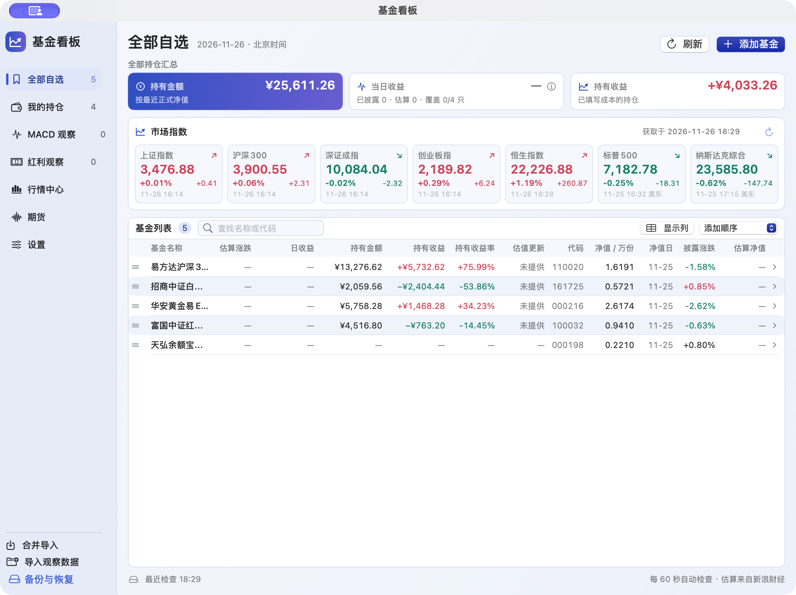

# 基金看板 FundDesk

在电脑上查看公募基金净值、盘中参考估值和市场行情，记录自选、持仓及交易流水。提供 macOS 原生应用和 Chrome 扩展，数据保存在各自设备上。

**[下载安装包](https://github.com/JazZ301/FundDesk/releases/latest) · [查看详细使用说明](docs/使用指南.md)**



*截图使用公开基金名称和虚构的份额、成本。由这些份额和成本计算出的收益同样仅供演示。*

## 安装

| 版本 | 系统要求 | 文件 |
| --- | --- | --- |
| macOS 原生版 | macOS 13 或更新版本，Apple 芯片 | `FundDesk-0.3.28-macOS-arm64.dmg` |
| Chrome 扩展 | Windows 或 macOS，Chrome 130 或更新版本 | `FundDesk-Chrome-0.1.0.zip` |

- **macOS**：打开 DMG，把「基金看板」拖到「应用程序」，再从「应用程序」打开。安装包采用临时签名，首次打开时可能被 Gatekeeper 拦截，详见[安装说明](docs/使用指南.md#macos)。
- **Chrome**：解压 ZIP，在 `chrome://extensions` 启用「开发者模式」，点击「加载已解压的扩展程序」，选择包含 `manifest.json` 的 `ChromeExtension` 文件夹。点击扩展图标，再点「打开完整看板」。

## 开始使用

1. 点「添加基金」，输入基金代码、名称或拼音。添加后可先放在自选里观察。
2. 打开基金详情，在底部填写「持有份额」和「单位成本」，保存后即可查看持有金额和收益。后续买卖、分红等操作可用「持仓流水」记录。
3. 点击指数卡片看分时走势。macOS 也可以从菜单栏查看上证指数，或从侧栏进入「行情中心」及「期货」。
4. 更换设备前，导出完整 JSON 备份。macOS 从侧栏打开「备份与恢复」，Chrome 从「设置」进入该功能。

## 从源码运行

构建应用需要 Swift 5.9 或更新版本。在仓库根目录运行：

```sh
swift run FundDesk
bash scripts/package.sh
```

打包文件位于 `dist/`。开发或演示时，可把 `FUND_DESK_DATA_DIR` 指向一个单独目录。

Swift 回归测试需要支持 Swift Testing 的 Swift 6 或更新版本，运行 `swift test`。如果独立安装的 Apple Command Line Tools 提示无法找到 `TestingMacros`，且本机存在对应的插件文件，可运行：

```sh
swift test -Xswiftc -load-plugin-library \
  -Xswiftc "$(xcode-select -p)/usr/lib/swift/host/plugins/testing/libTestingMacros.dylib"
```


Chrome 可直接加载仓库中的 `ChromeExtension` 目录。扩展回归测试使用 Node.js 22 或更新版本：

```sh
node --test scripts/chrome/regression.mjs
```
