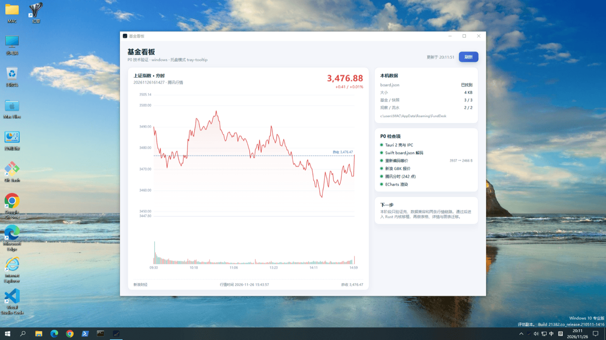

# P0 验证记录

日期：2026-11-26（北京时间）

## 结论

macOS 与 Windows 10 的最小链路均已跑通：桌面壳、真实看板解码、两条行情源、图表、托盘常驻与单实例恢复。

## 已验证

### 1. 桌面壳与 IPC

- `pnpm tauri dev` 启动成功，进程 `target/debug/funddesk`。
- 前端通过 `invoke` 读取本机看板、报价和分时。
- 单实例插件加载，关闭主窗口后进程保留。

### 2. board.json 兼容

真实数据（只读）：

| 项目 | 值 |
| --- | --- |
| 文件大小 | 791,132 B |
| 基金 / 快照 | 17 / 17 |
| 观察数据 | 17 |
| 重编码后 | 791,084 B（数字格式与键顺序不同） |
| 排序并规范化后 diff | 0 行 |

验证方式：`cargo test -p funddesk-core -- --ignored real_board_roundtrip`。

过程中发现 `hiddenFundColumnIDs` 被 serde 的 camelCase 规则写成 `hiddenFundColumnIds`，导致该字段静默丢失；已改为显式重命名，并在往返检查中加入顶层字段缺失检测。

### 3. 行情链路

- 新浪 `hq.sinajs.cn`：带 `Referer`，GBK 解码成功；样本 `2026-11-26 15:43:57`，上证 3,476.88，+0.41，+0.01%。
- 腾讯 `web.ifzq.gtimg.cn` 分时：242 个点，昨收 3,476.47，成交量为相邻分钟累计值做差。

### 4. 图表

ECharts 绘制分时、昨收虚线与分钟成交量，悬停显示时间和涨跌。

### 5. 托盘

- macOS 菜单栏显示走势图标 +「上证 +0.41」，每 60 秒刷新。
- 图标使用 44×44 模板图（`src-tauri/icons/tray.png`），随系统深浅色自动反色。
- 已验证：关闭主窗口后进程保留；点击状态项重新显示窗口。
- 文字采用 Tauri `set_title`，当前为单色；彩色涨跌文字留到 P4。

### 6. Windows 10 运行环境

- Parallels Windows 10 Pro ARM64（Build 21382），WebView2 Runtime 158.0.4370.33。
- 本轮安装 VS 2022 Build Tools（MSVC 14.44 + Windows SDK 10.0.26100）与 Rust 1.100。
- 使用 vendored 的 3 基金合成看板（`crates/core/tests/fixtures/board-v4.json`）作为 `%APPDATA%\FundDesk\board.json`。

### 7. Windows 10 构建与运行

- `cargo build --release --features custom-protocol` 成功，产物 7.47 MB。
- 启动后读取合成看板：3 基金 / 3 快照 / 2 观察，往返检查通过。
- 新浪 GBK 报价与腾讯 242 点分时均成功，ECharts 正常渲染。
- `CloseMainWindow` 后进程保留、窗口隐藏；再次启动 exe 由单实例插件唤回原窗口（同一 PID）。
- 托盘图标由 Tauri 创建成功；浮层与左键交互随 P4 一起验收。



### 8. macOS 生产构建

- `cargo build --release --features custom-protocol` 产物 10 MB，脱离 dev server 单独启动成功。
- 菜单栏图标与「上证 +0.41」在 release 下正常。

## 构建坑

1. **必须启用 `custom-protocol`**：缺失时 release 包仍加载 `http://localhost:1420`，表现为空白/连接拒绝。已在 `src-tauri/Cargo.toml` 增加同名 feature。
2. **不要用 fat LTO**：本机工具链下 `lto = true` 会生成损坏的 proc-macro dylib（`mis-aligned LINKEDIT string pool`），改为 `lto = "thin"` 后正常。
3. Windows 首次构建需把 crates.io 索引切到镜像，否则索引阶段会长时间无进展。

## 待完成

- NSIS 打包冒烟（可延后到 P6）。
- macOS 通用二进制与签名（P6）。
- Windows x64 的 CI 产物（当前实机为 ARM64）。
- Windows 托盘浮层与左键交互（P4）。

## 复现命令

```sh
cd fund_win
pnpm install
pnpm tauri dev

cargo test -p funddesk-core
FUND_DESK_REAL_BOARD="$HOME/Library/Application Support/FundDesk/board.json" \
  cargo test -p funddesk-core -- --ignored real_board_roundtrip
```
