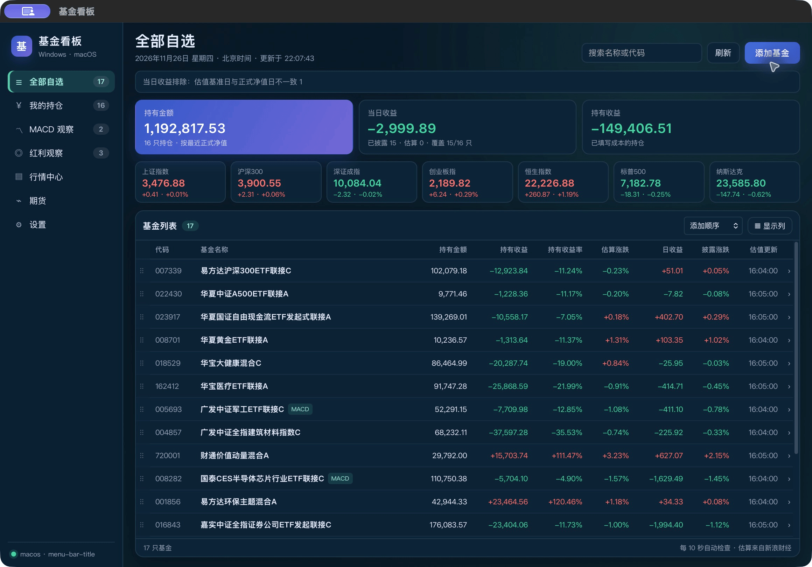
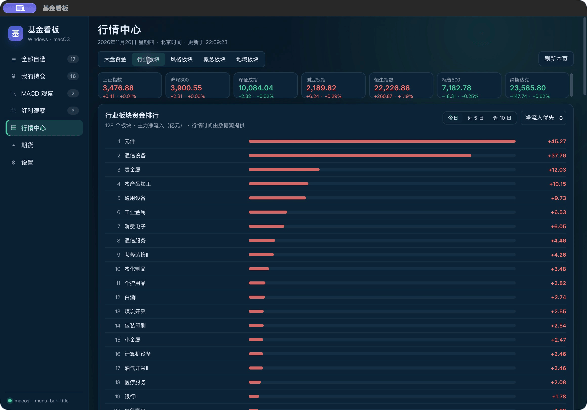
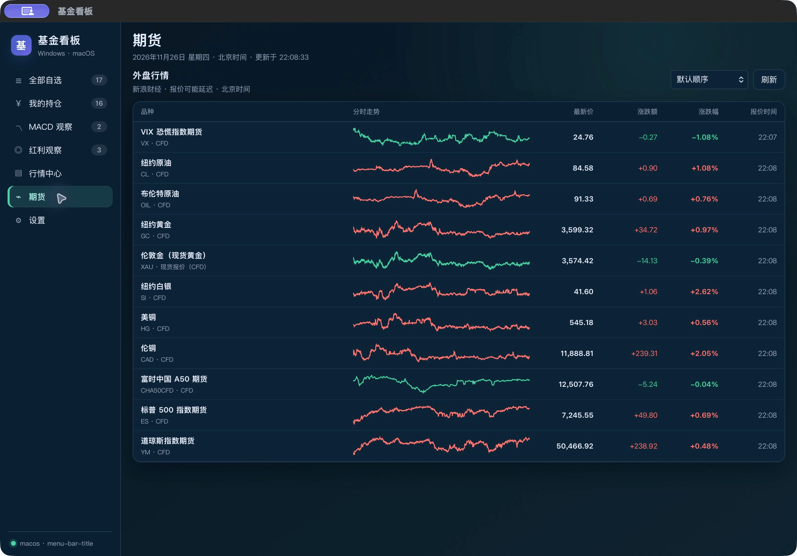
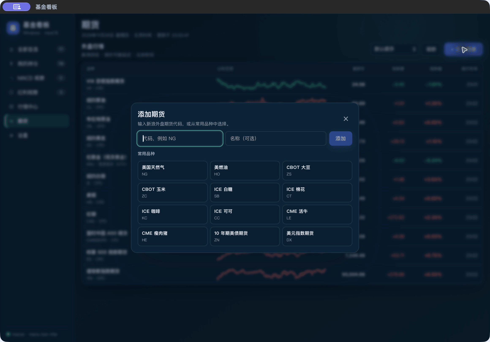
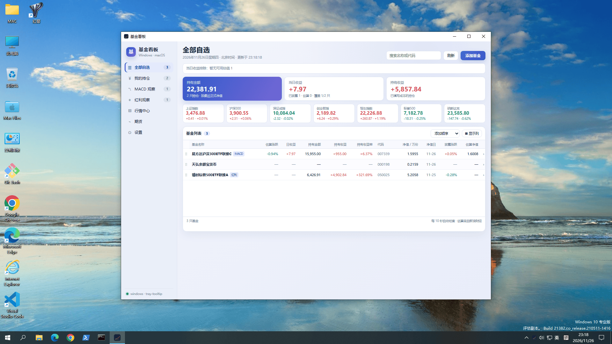
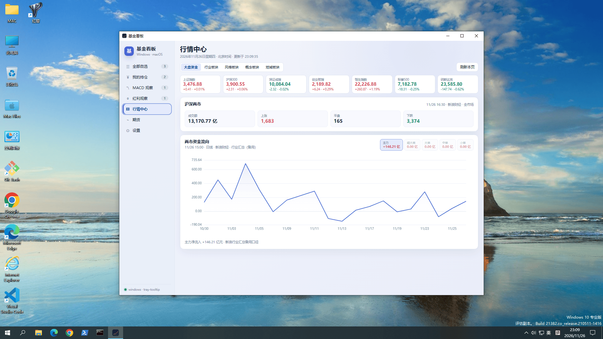
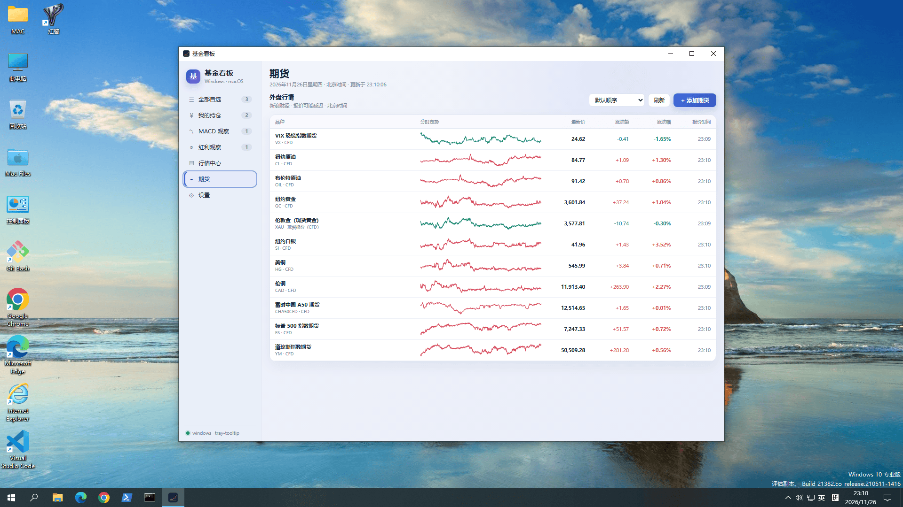
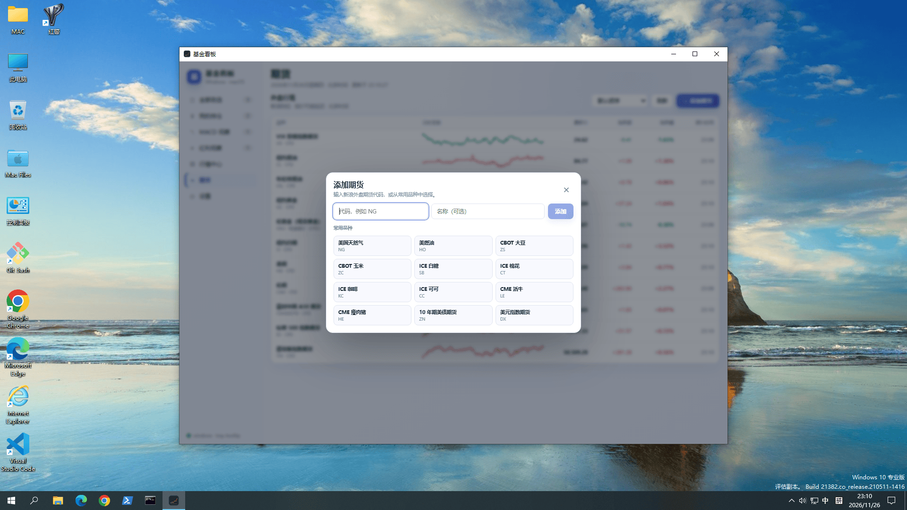

# P3 界面迁移与调度接入

更新于 2026-11-27。P3 完成主表、基金详情、行情中心、期货、观察数据和设置页的 React 迁移，
并把桌面端后台调度器接到真实 `board.json`。

## 已完成界面

### 主表

- 全部自选、我的持仓、MACD 观察、红利观察四种列表过滤。
- 12 个可选列，按 `fundColumnOrder` / `hiddenFundColumnIDs` 持久化显示列与顺序。
- 表头拖动调整列序；点击可排序列切换升序/降序；添加顺序恢复原始顺序。
- 行拖动调整基金顺序，拖到目标行上半区/下半区分别插入前后。
- 名称、代码、估值、日收益、持有金额、持有收益、收益率、净值日、估值时间等逐列显示。
- MACD / 红利分组标签与详情内分组开关。
- 顶部汇总卡、七指数行情条、添加基金弹窗、`Cmd/Ctrl + F/N/R` 快捷键。

### 基金详情

- 详情标签按 `fundDetailTabOrder` 持久化；可拖动排序，默认打开第一个可见标签。
- 净值估算、历史净值、累计收益、披露持仓、基金概况、观察数据；基金经理并入基金概况。
- 顶部并排显示正式净值和盘中估算；底部常驻本地持仓，可编辑份额和成本。
- 估值分时、披露个股行情和目标 ETF 披露由 Rust 端补齐。
- 历史净值与累计收益支持近 1 月到成立以来七档区间。
- 观察数据展示指标、MACD 评级、估值锚点、净值序列与 MACD 柱/DIF/DEA。
- 观察数据按分组显示 MACD 适配度、净值与 MACD 双区图，或红利估值锚、分位和相对强弱。
- 份额与成本编辑、从自选移除。申购、赎回和分红流水由基金销售平台维护，本应用不记录。
- 详情数据走分块缓存：历史净值 24 小时，档案/披露/经理 7 天；网络失败时回退旧缓存。

### 行情中心

- 大盘资金、行业板块、风格板块、概念板块、地域板块。
- 七指数分时 + 成交量双区图，支持上证、沪深 300、深证、创业板、恒生、标普、纳指时区。
- 沪深两市成交额与涨跌家数；资金流主力/超大单/大单/中单/小单切换与分时曲线。
- 板块今日/近 5 日/近 10 日排行、净流入/净流出排序和比例条。
- 数据源局部失败时保留可用区块，并把错误压缩为可读提示。
- 东方财富 `push2*` 域名不可达时，自动切换到免费的新浪财经备用源：
  全市场快照统计沪深涨跌家数与成交额，48 个新浪行业资金流汇总生成近 20 日主力净流入。
- 备用资金流只提供主力口径，超大单/大单/中单/小单保持禁用，界面明确标注
  `新浪财经 · 行业汇总（备用）`，不把它伪装成东方财富原始数据。

### 期货

- 11 个外盘品种报价、涨跌额/涨跌幅、报价时间与分时缩略图。
- 右上角 `+ 添加期货` 支持输入新浪外盘代码，或从 12 个常用品种中快捷添加；
  自定义品种可移除，自选列表保存到数据目录下的 `futures-watchlist.json`。
- 分时、五日、日 K、周 K、月 K 五个周期。
- 分时均价线、参考价、五日分钟序列回退、K 线最近 120 根、MACD（12/26/9）。
- 今开、最高、最低、参考价、振幅、持仓量。

### 设置

- 跟随系统/白色/黑色主题，写入 `board.json` 并立即生效。
- 5/10/30/60 秒自动刷新间隔。
- 本机数据目录、隐私说明与数据来源提示。

## 调度器

`src-tauri/src/lib.rs` 启动两条后台循环：

1. **指数/托盘循环**：每 60 秒请求七指数，更新上证托盘文字与提示，并广播
   `market://indices`。
2. **看板刷新循环**：每秒检查 `board.refreshIntervalValue()`，到点后并发刷新最多 4 只基金。
   正式净值每 20 分钟检查，失败后 4 分钟重试；盘中估值按调度器退避策略请求。
   无变化时仍广播新的 `board://updated` 供界面更新时间，有变化时原子写回 `board.json`
   与 `board.backup.json`。

手动刷新、托盘“刷新行情”和设置页间隔共用同一个防重入标记，避免并行写盘。

## 新增 IPC

- `save_visible_columns` / `reorder_columns`
- `move_fund`
- `set_groups`
- `move_detail_tab`
- `futures_intraday`
- `add_futures` / `remove_futures`

所有行情、基金检索、净值与缓存请求仍在 Rust 侧完成；前端只负责格式化与交互。

## 验证记录

- `pnpm build`：TypeScript + Vite 通过，产物约 1.24 MB JS / 23.6 KB CSS。
- `cargo clippy -p funddesk-core -p funddesk --features funddesk/custom-protocol --all-targets -- -D warnings`：通过。
- `cargo test -p funddesk-core`：57 项通过（单元 25、golden 8、行情 12、档案 7、往返 5）。
- 联网测试：2 项通过；真实 791 KB `board.json` 只读往返通过。
- macOS：实机检查主表、详情、观察、披露持仓、行情中心、板块和期货，调度器按 10 秒设置持续广播。
- macOS 备用源：行情中心成交额约 `13,170.77 亿`，上涨 `1,683` / 平盘 `165` /
  下跌 `3,374`，主力资金流约 `+146.21 亿`，来源显示 `新浪财经 · 行业汇总（备用）`。
- macOS 期货添加：添加 `NG` 后列表、分时、五日回退、日 K、周 K、月 K 均正常，
  `futures-watchlist.json` 正确写入 `{"symbol":"NG","title":"美国天然气"}`。
- macOS release：`cargo build --release --features custom-protocol` 产物 12 MB，`tauri://localhost`
  独立启动成功，行情中心在无 dev server 下正常加载。
- Windows 10 x64：NSIS 安装包安装后启动成功，备用源统计、资金流和 `+ 添加期货`
  弹窗均正常；x64 包在 ARM64 Windows 主机上通过系统模拟运行。

## 截图

## 已知边界

- 东方财富 `push2.eastmoney.com`、`push2delay`、`push2his` 在当前网络整域返回空响应；
  `data.eastmoney.com` 的板块接口仍正常。涨停/跌停、分时资金流细项等依赖 `push2*`
  的字段会降级或隐藏，由新浪备用源补齐核心统计。
- 新浪备用资金流是行业汇总的近似口径，仅主力净流入；接口不可用时仍保留成交额与
  已有缓存，不会填造超大单/大单/中单/小单数据。
- 自定义期货依赖新浪外盘代码与 `GlobalFuturesService`；代码不存在或无报价时添加会失败，
  五日分钟线缺失时回退为最近五个交易日日线。
- Windows 托盘仍为系统托盘图标 + tooltip；彩色指数托盘和左键浮层属于 P4。
- 合并导入、观察文件夹导入、完整备份/CSV 导入导出仍属于 P5。
- Windows x64 NSIS 与 macOS universal DMG 已在 P6 产出；Developer ID、公证和
  Windows 正式代码签名仍受签名证书缺失阻塞。
- P6 已将 Tauri 版独立为「基金看板 / FundDesk / app.funddesk.desktop」，数据目录改为
  `FundDeskDesktop`，首次启动自动迁移旧 `FundDesk` 数据；不会覆盖 Swift 原生版。
