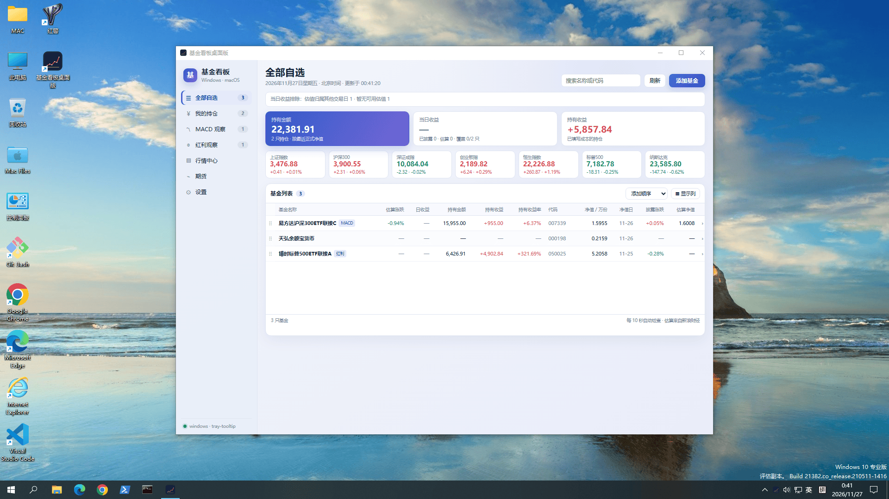

# P6 安装包、签名与公证

更新于 2026-11-28。首个公开候选版本为 `1.0.0`。

## 独立身份

| 项目 | 值 |
| --- | --- |
| 产品名 | 基金看板（英文名 FundDesk） |
| Bundle ID | `app.funddesk.desktop` |
| 版本 | `1.0.0` |
| macOS 最低版本 | 12.0 |
| Windows 目标 | Windows 10 x64 / NSIS 当前用户安装 |

新版本不再使用 Swift 版的旧 bundle identifier，但应用显示名同为「基金看板」。
安装前请退出并移走同名的 Swift 原生版，避免覆盖旧应用。数据目录改为
`FundDeskDesktop`：

- macOS：`~/Library/Application Support/FundDeskDesktop`
- Windows：`%APPDATA%\FundDeskDesktop`

首次启动且新目录没有看板数据时，会从旧 `FundDesk` 目录复制 `board.json`、
`board.backup.json`、`catalog.json`、`research-v1/`、`restore-points/` 和
`futures-watchlist.json`。旧目录保留不删除，两个版本此后独立运行。
`FUND_DESK_DATA_DIR` 仍可覆盖数据目录，并跳过自动迁移。

## 图标

早期预览使用手工创建的 `/tmp/FundDeskPreview.app` wrapper，其 `Info.plist` 没有
`CFBundleIconFile`，因此 Finder/Dock 显示通用网格占位图。正式 Tauri bundle 已修复：

- macOS：`Contents/Resources/icon.icns`，`CFBundleIconFile = icon.icns`。
- Windows：EXE 和 NSIS 安装程序均嵌入 `src-tauri/icons/icon.ico`。
- NSIS 使用 `installerIcon` / `uninstallerIcon` 指向同一图标。


实测从 DMG 安装后的 App、Windows 快捷方式和 NSIS 安装程序都能显示折线图图标。

## 产物

| 平台 | 文件 | 大小 | SHA-256 |
| --- | --- | --- | --- |
| macOS universal | `FundDesk-1.0.0-macOS-universal.dmg` | 12.5 MB | `c2242b623a319983fac79a342df2663baacf27fa3c0697f05ecf09b31b70ab80` |
| Windows x64 | `FundDesk-1.0.0-Windows-x64-setup.exe` | 3.0 MB | `18544e5609d8af61151828c4125b60116e870352745b8922b77ac2887c9b5061` |

产物位于 `release/`，校验和同时写入 `release/SHA256SUMS.txt`。GitHub Release
资产使用 ASCII 文件名，避免平台把中文资产名替换为下划线。

| 产物 | 架构 | 说明 |
| --- | --- | --- |
| macOS App | universal `x86_64 + arm64` | DMG 内含 App 和 `/Applications` 链接 |
| Windows App | `x86_64` | 在 Windows 10 ARM64 上通过系统模拟运行 |
| NSIS 安装器 | `x86` bootstrap | 安装 x64 App，WebView2 使用 downloadBootstrapper |

## 验证记录

### macOS

- `hdiutil verify`：DMG 校验和有效。
- `codesign --verify --deep --strict`：通过，签名为 ad-hoc。
- `lipo -info`：`x86_64 arm64`。
- `spctl -a -vv`：`rejected`，原因是 ad-hoc 签名没有 Developer ID。
- `xcrun stapler validate`：没有公证 ticket。
- 从 DMG 覆盖安装到 `/Applications/基金看板.app` 后启动成功，
  `CFBundleIdentifier = app.funddesk.desktop`，窗口标题和菜单栏显示「基金看板」。
- 首次启动从旧 `FundDesk` 目录迁移成功，保留 17 只基金、17 份快照和设置。
- 2026-11-27 逐页对齐 Swift 版后重新安装，实机复核主表、基金详情五标签、估值分时、
  历史净值、MACD 观察、目标 ETF 展开、设置、行情中心和期货详情；正式数据目录保留。


### Windows

- NSIS 静默安装到 `C:\Users\<用户>\AppData\Local\基金看板`，开始菜单快捷方式创建成功。
- 安装后的 `funddesk.exe` 为 x86_64 PE，图标为折线图。
- EXE 版本信息为 ProductName `基金看板`、FileVersion/ProductVersion `1.0.0`。
- 在 Windows 10 ARM64 上启动 x64 安装版成功，主表显示迁移后的 3 只基金。
- Authenticode 状态：`NotSigned`。安装包和 EXE 均未签名。
- 2026-11-27 逐页对齐 Swift 版后重新构建 NSIS。首次在 `SYSTEM` 会话安装会写入
  `systemprofile`，不能更新当前用户版本；本轮改为在交互式 `MAC` 用户会话执行安装，
  安装后的 `funddesk.exe` 时间戳与构建一致，启动后的主表已显示新版布局且不再出现旧版名称标签。
- 2026-11-27 17:42 补发数据源配置和免责声明版本。虚拟机内旧安装版为 11:08 构建，
  早于数据源配置化；结束旧进程后在交互式 `MAC` 会话静默覆盖安装，安装后的
  `funddesk.exe` 为 11,676,160 字节、时间戳 17:42。使用隔离演示数据启动后，
  设置页可找到「数据源」「配置数据源」「关于与免责声明」，并能打开包含
  「选择配置文件」「保存并应用」「清空配置」的数据源配置弹窗。



## 签名与公证现状

本轮机器没有可用的发布签名材料：

- `security find-identity -v -p codesigning`：`0 valid identities found`
- `xcrun notarytool history --keychain-profile AC_PASSWORD`：没有该钥匙串配置
- Windows 证书存储：没有 Code Signing 证书

因此本轮完成的是 **ad-hoc 签名 + DMG/App 完整性验证**，不是可公开分发的
Developer ID 签名版本。DMG 和 App 的 `spctl` 均被拒绝，macOS 首次打开会被
Gatekeeper 拦截；Windows 安装器会触发 SmartScreen 未知发布者提示。

这属于签名材料缺失，不是打包或代码错误。要生成公开可信版本，需要：

1. Apple Developer Program 的 `Developer ID Application` 证书及私钥。
2. Apple ID 专用密码或 App Store Connect API Key。
3. Windows 代码签名证书（OV/EV 或 Azure Trusted Signing）。

## 配置后的签名命令

macOS 本机安装证书后：

```sh
security find-identity -v -p codesigning
xcrun notarytool store-credentials AC_PASSWORD \
  --apple-id "you@example.com" \
  --team-id "TEAMID" \
  --password "app-specific-password"

APPLE_SIGNING_IDENTITY="Developer ID Application: Your Name (TEAMID)" \
APPLE_NOTARY_PROFILE=AC_PASSWORD \
scripts/build-macos-dmg.sh
```

也可以改用 `APPLE_ID` / `APPLE_PASSWORD` / `APPLE_TEAM_ID` 环境变量。
脚本会完成 App 签名、公证、staple、DMG 创建、DMG 签名、DMG 公证和 staple。

Windows 可将 PFX 导入证书存储，然后用 Tauri 的
`bundle.windows.certificateThumbprint` 配合 `signtool` 签名；CI 已支持：
本机可设置 `WINDOWS_CERT_THUMBPRINT` 后运行 `scripts\build-win-x64.bat`，
脚本会临时生成仅含证书指纹的签名配置。

| Secret | 用途 |
| --- | --- |
| `APPLE_CERTIFICATE` / `APPLE_CERTIFICATE_PASSWORD` | base64 p12 和密码 |
| `APPLE_SIGNING_IDENTITY` | Developer ID Application 名称 |
| `APPLE_ID` / `APPLE_PASSWORD` / `APPLE_TEAM_ID` | 公证账号 |
| `WINDOWS_CERTIFICATE` / `WINDOWS_CERTIFICATE_PASSWORD` | base64 PFX 和密码 |

未配置对应 secret 时，CI 仍会产出未签名/ad-hoc 构建，不会伪造签名状态。

## 构建命令

```sh
# macOS universal App + DMG
scripts/build-macos-dmg.sh
```

```bat
:: Windows x64 NSIS
scripts\build-win-x64.bat
```

## 已知边界

- macOS Intel 真机未单独启动验证；已用 `lipo` 确认 universal 二进制包含 x86_64。
- Windows x64 在 ARM64 Windows 上通过系统模拟运行，未在独立 Intel 机器上重复验证。
- 正式公开分发前必须补齐 Developer ID、公证和 Windows 代码签名；当前产物只能作为
  内部测试或未签名预览包。
- 自动更新（Tauri updater / latest.json）本轮未接入，只有安装包产物。
- 代码采用 MIT License；第三方依赖和行情数据不因本项目的许可证而改变授权状态。
