# FundDesk（基金看板）使用指南

FundDesk（基金看板）是一个本地优先的基金与市场行情看板，支持 macOS 和 Windows。它不需要账号，不连接自建服务端，自选、持仓和设置都保存在本机。安装包自带默认数据源配置，下载后即可使用，也可以替换为自己的接口地址。

> 本文截图使用 `demo/board.demo.json` 中的 8 只**虚构持仓**生成。份额、成本、金额和收益均为演示值，不对应任何人的真实账户。截图中的指数、净值和估值是 2026-11-27 的公开行情快照，之后会发生变化；行情数据版权归来源网站所有，截图仅用于说明界面。

截图来自 macOS 版；Windows 版的功能和布局一致，只是窗口边框、托盘和菜单栏表现不同。

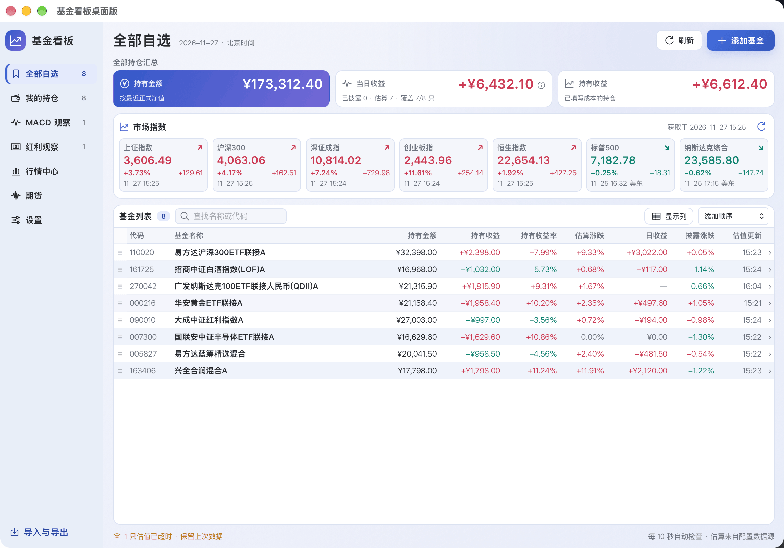

## 目录

- [1. 主要功能](#1-主要功能)
- [2. 安装与首次启动](#2-安装与首次启动)
- [3. 看板与基金列表](#3-看板与基金列表)
- [4. 添加基金与编辑持仓](#4-添加基金与编辑持仓)
- [5. 基金详情](#5-基金详情)
- [6. MACD 观察与红利观察](#6-macd-观察与红利观察)
- [7. 行情中心](#7-行情中心)
- [8. 期货](#8-期货)
- [9. 设置](#9-设置)
- [10. 批量导入持仓](#10-批量导入持仓)
- [11. 菜单栏与托盘](#11-菜单栏与托盘)
- [12. 数据目录、备份与迁移](#12-数据目录备份与迁移)
- [13. 常见问题](#13-常见问题)
- [14. 隐私与免责声明](#14-隐私与免责声明)

## 1. 主要功能

- 自选基金列表、持有金额、持有收益、当日收益和估算涨跌。
- 7 个常用市场指数卡片，以及指数分时、板块和资金流。
- 基金详情：持仓明细、净值估算、历史净值、累计收益、基金概况。
- MACD 观察与红利观察两个研究分组。
- 全球期货行情与自选品种。
- 通过 AI 模板和文本批量导入基金持仓。
- macOS 菜单栏常驻上证指数，关闭窗口后继续在后台刷新。

## 2. 安装与首次启动

### macOS

系统要求：macOS 12 或更高版本。发布包为 universal 版本，同时支持 Apple Silicon 和 Intel。

1. 从 Releases 下载 `.dmg` 和 `SHA256SUMS.txt`。
2. 打开 DMG，把「基金看板」拖到「应用程序」。
3. 首次启动如果被系统拦截，打开「系统设置 → 隐私与安全性」，在底部选择「仍要打开」。

当前 macOS 安装包使用 ad-hoc 签名，**没有经过 Apple 公证**。这不影响本地运行，但首次启动会出现系统提示。如果不想使用未公证的安装包，可以按根目录 `README.md` 的开发说明从源码构建。

校验安装包：

```sh
shasum -a 256 FundDesk-1.0.0-macOS-universal.dmg
```

将输出与 `SHA256SUMS.txt` 中的值比较。

### Windows

系统要求：Windows 10/11 x64。安装程序会在需要时下载 WebView2 运行时，因此首次安装需要联网。ARM64 Windows 可以通过系统模拟运行 x64 包，但目前没有原生 ARM64 安装包。

1. 从 Releases 下载 `*-setup.exe` 和 `SHA256SUMS.txt`。
2. 运行安装程序。当前 Windows 安装包**没有 Authenticode 签名**，SmartScreen 可能提示「Windows 已保护你的电脑」；确认文件来源和校验值后，可选择「更多信息 → 仍要运行」。
3. 安装程序为当前用户安装，不需要管理员权限。

校验安装包：

```bat
certutil -hashfile FundDesk-1.0.0-Windows-x64-setup.exe SHA256
```

### 首次启动

- 首次启动会创建本地数据目录，并尝试从旧版 `FundDesk` 目录复制看板、缓存和期货自选；旧目录不会被删除。
- 新目录已经有 `board.json` 或 `board.backup.json` 时不会重复迁移。
- 安装包自带默认接口配置（`resources/data-sources.json`），首次启动会复制到本机数据目录，无需额外导入即可加载行情。
- 配置完成后，应用会自动检查自选基金行情。没有自选时，点击右上角「添加基金」开始。

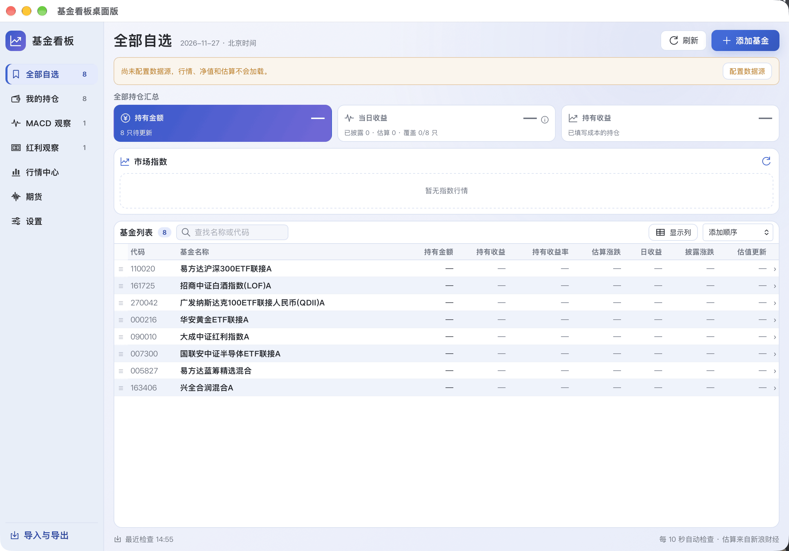

### 数据源配置

数据源地址不写死在程序里。安装包内的 `resources/data-sources.json` 提供默认接口，首次启动时复制到本机数据目录的 `data-sources.json`；之后可以直接编辑这个文件，或导入自己的配置。已有的本机配置不会被升级覆盖。

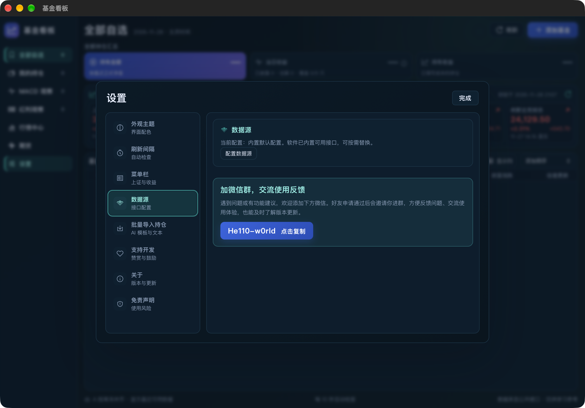

> 截图中的 `example.com` 地址仅用于演示配置格式，不是可用的行情接口。

1. 点击顶部提示中的「配置数据源」，或打开「设置 → 数据源 → 配置数据源」。
2. 选择 `data-sources.json` 文件，或直接粘贴 JSON 文本。
3. 点击「保存并应用」，然后回到看板刷新。
4. 如需回到安装包自带的配置，点击「恢复内置默认」。

配置文件包含以下几组地址：

| 字段 | 用途 |
| --- | --- |
| `eastmoney.*` | 基金目录、搜索、净值、档案、披露、板块和资金流 |
| `sina.*` | 指数、盘中估值、全市场快照和外盘期货 |
| `tencent.*` | 指数卡和分时 |
| `yahoo.query1` | 可选；留空时美股指数分时回退到东方财富 |
| `http.userAgent` | 请求标识，默认 `FundDeskDesktop/1.0` |

所有地址必须使用 HTTPS；只有 `localhost` 或 `127.0.0.1` 允许 HTTP。应用会检查 URL 格式、拒绝带用户名/密码或查询参数的地址，并在保存前显示缺少的字段。

默认配置使用公开的第三方行情接口，可能随时调整或限流；不要导入包含账号密码、未知代理或要求关闭系统安全设置的文件。数据源配置不构成官方授权或数据准确性保证。

字段清单和分发注意事项见[数据源配置](数据源配置.md)。

## 3. 看板与基金列表

左侧导航分为：

| 入口 | 说明 |
| --- | --- |
| 全部自选 | 所有加入看板的基金，包括观察分组 |
| 我的持仓 | 只显示已填写份额且份额大于 0 的基金 |
| MACD 观察 | 手动加入 MACD 研究分组的基金 |
| 红利观察 | 手动加入红利研究分组的基金 |
| 行情中心 | 指数、板块和资金流 |
| 期货 | 外盘期货行情 |
| 设置 | 主题和刷新间隔 |

主区域上方是三张汇总卡：

- **持有金额**：按最近一次正式净值计算。部分基金尚未更新时会显示「待更新」数量。
- **当日收益**：优先使用已披露的正式净值；未披露时使用盘中估算。QDII、货币基金、估值基准日不一致等情况可能被排除，卡片下方会显示覆盖数量。
- **持有收益**：只统计已经填写单位成本的持仓。

基金列表常用操作：

- 点击基金名称进入详情；返回后恢复之前的列表和滚动位置。
- 用搜索框按名称或六位代码过滤。macOS 按 `Cmd+F`、Windows 按 `Ctrl+F` 可直接聚焦搜索框。
- 点击表头排序；再次点击切换方向。
- 拖动表头调整列顺序，或用「显示列」隐藏不需要的列。
- 拖动行首的手柄调整「添加顺序」。
- 在基金行上点右键，可在「分组」中勾选加入或取消 MACD 观察、红利观察。
- 右上角「刷新」立即检查自选基金；自动刷新间隔在设置中修改。

列表底部会显示数据状态。A 股周末或节假日休市时，列表显示「休市 · 显示最近可用数据」。交易日的旧估值会提示「估值已过期」。

## 4. 添加基金与编辑持仓

### 添加基金

1. 点击右上角「添加基金」。
2. 输入基金名称、拼音首字母或六位代码。
3. 在搜索结果中点击目标基金。

第一次搜索可能需要下载基金目录，耗时比后续搜索长。

在「MACD 观察」或「红利观察」页面点击「添加基金」时，搜索结果会显示「加入 MACD 观察」或「加入红利观察」。已经在全部自选中但尚未加入当前分组的基金也可以直接加入；已经在该分组中的基金显示「已添加」。

添加成功后会短暂显示提示。在「我的持仓」页面添加新基金时，应用会切换到「全部自选」并显示该基金；填写份额后才会出现在「我的持仓」。

如果尚未配置数据源或搜索接口暂时不可用，输入六位代码后会出现「直接添加代码」入口，可以先加入看板，名称和行情会在数据源恢复后补全。

### 编辑持仓

1. 点击基金名称进入详情。
2. 在底部「本地持仓」区域点击「编辑持仓」。
3. 填写持有份额和单位成本，保存。

- 份额留空保存会清除该基金的持仓，但不会把基金从自选中删除。
- 单位成本用于计算持有收益，可以留空；留空时只显示金额和当日收益。
- 本地持仓只显示四位小数的单位成本。即使两个平台显示的成本价相同，计算时保留的小数位数不同，持有收益也可能有差异。
- 货币基金按份额计算金额，不要求填写单位成本。

基金看板只维护当前持有份额和单位成本。申购、赎回和分红记录由基金销售平台负责，本软件不记录交易流水；持仓发生变化时，请直接修改并保存当前份额和单位成本。

所有持仓只保存在本机。

## 5. 基金详情

详情页在主区域内打开，左侧导航仍然保留。页头显示正式净值和盘中估算；点击「‹ 返回」回到基金列表。

详情页包含六个标签，按住标签左右拖动即可调整顺序：

### 持仓明细

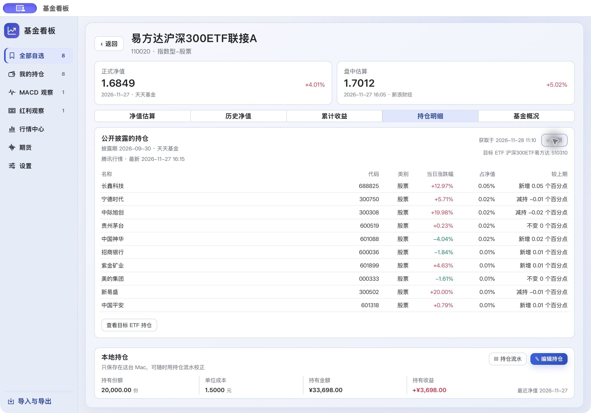

- 显示基金最近一期公开披露的股票或债券持仓、占净值比和较上期变化。
- 如果基金是 ETF 联接基金，会显示目标 ETF 代码，并可按需展开目标 ETF 的持仓。
- 表格中的「较上期」显示相对上一披露期的仓位变化；公开披露存在滞后，不是实时持仓。
- 「获取于」是本地最近一次成功读取披露数据的时间。
- 页面底部始终保留「本地持仓」，显示持有份额、单位成本、持有金额和持有收益，可直接编辑。

### 净值估算

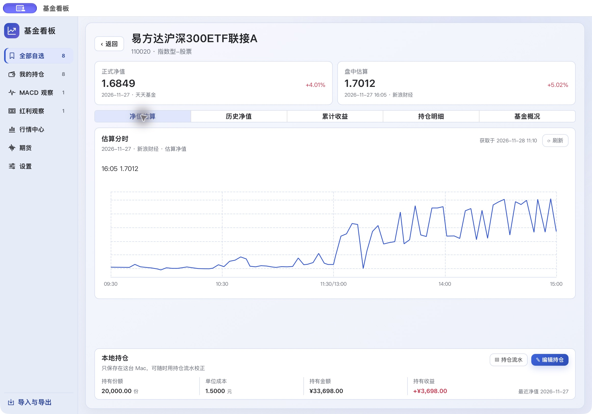

- 交易时段内显示估算分时和最新估算值。
- 估算来自新浪财经，不是基金公司公布的正式净值。
- 页头同时显示正式净值、盘中估算以及各自的更新时间和来源；涨跌颜色只表示方向。
- QDII、海外基金、货币基金等可能没有估算分时；界面会显示数据源未提供，而不是伪造曲线。

### 历史净值

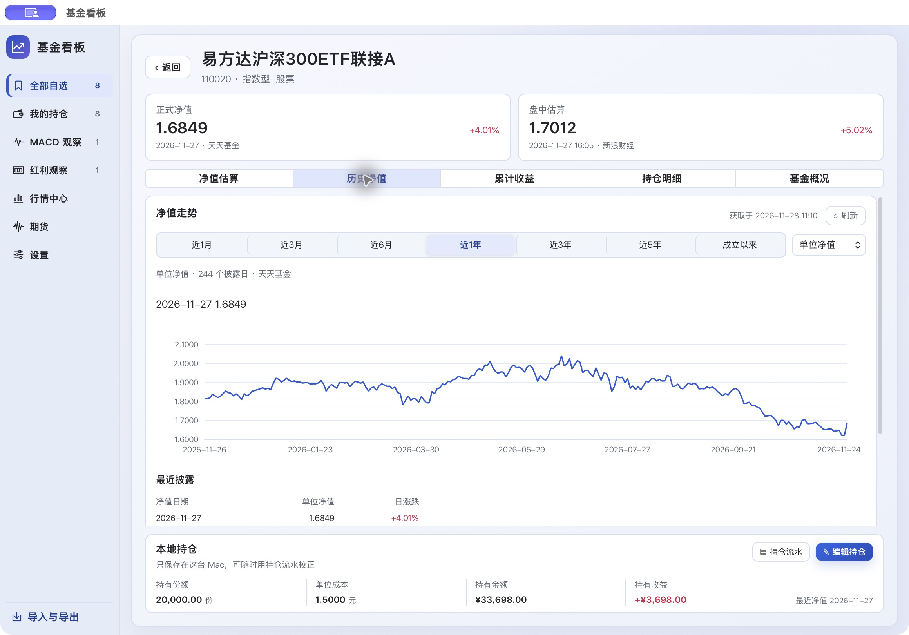

- 支持近 1 月、近 3 月、近 6 月、近 1 年、近 3 年、近 5 年和成立以来。
- 普通基金可切换单位净值和累计净值。
- 图表上方汇总当前区间的起始净值、结束净值、区间涨跌和样本天数。
- 下方列出最近 8 个披露日。

### 累计收益

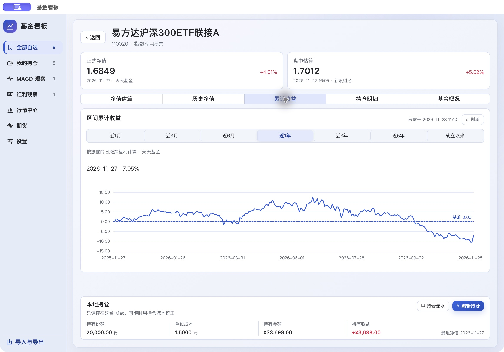

- 按披露的日涨跌复利计算区间收益。
- 与历史净值分别记忆区间，切换基金或标签不会互相覆盖。
- 累计收益曲线以区间起点为 0%，用于观察区间内累计涨跌，不等同于基金的累计净值。

### 基金概况

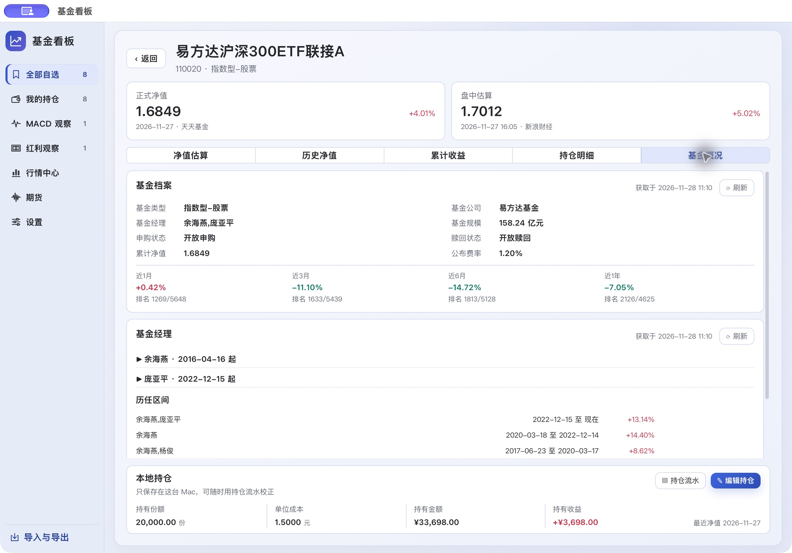

- 基金类型、规模、成立日、基金公司等档案信息。
- 区间收益、现任基金经理和历任经理区间。
- 基金经理简介为数据源披露的文字，可能随披露更新。

### 观察数据

「观察数据」只对 MACD 观察或红利观察分组中的基金显示，分别呈现 MACD 战法适配或红利估值锚。评分由本机根据公开历史净值自动计算，不需要导入评分文件；具体指标、图表和读取方法见下一节。

## 6. MACD 观察与红利观察

这两个分组是研究辅助，不是买卖建议。

加入分组后，应用会直接用公开历史净值自动计算观察数据，并在后台刷新时更新。首次打开新基金时可能需要几秒获取历史净值，之后会使用本机缓存。

### MACD 观察

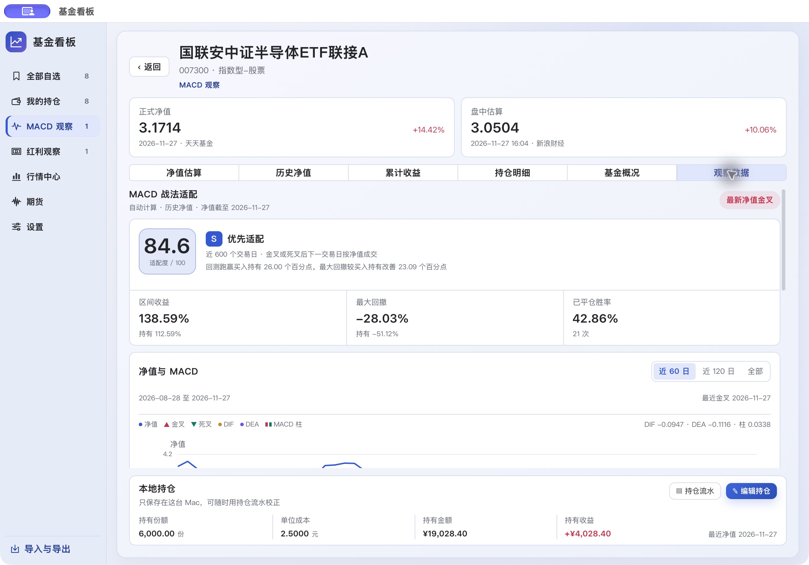

页面上方先给出适配度、等级和推荐语。示例中为 84.6 分、S、优先适配；三张对照卡分别显示策略与买入持有的区间收益、最大回撤，以及已平仓胜率。评分越高表示这段历史中 MACD 信号与基金净值的匹配程度越好，不代表未来收益。

- **适配度评分**：满分 100 分，由回测超额 35 分、回撤改善 25 分、已平仓胜率 20 分、波动空间 15 分和申购费率 5 分组成。等级和推荐语随评分更新。
- **回测对比**：使用最近最多 600 个交易日。策略以 12、26、9 参数计算 MACD，金叉或死叉后的下一交易日按净值模拟成交；收益未扣交易费，胜率只统计已平仓交易。
- **区间收益**：策略净值增长与同期买入持有的对照；**最大回撤**：策略从高点到低点的最大跌幅，并与持有对照；**已平仓胜率**：盈利平仓次数占全部已平仓交易的比例，括号内是交易次数。

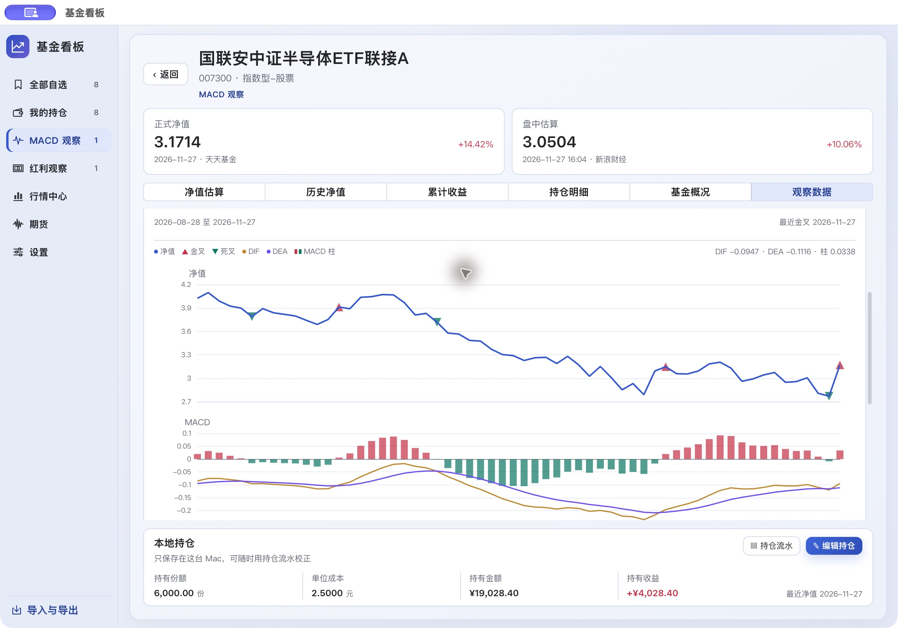

净值与 MACD 双图默认显示近 60 个交易日，可切换近 120 日或全部。上图是基金净值，三角形标记金叉和死叉；下图是 MACD，柱体在零轴上方为红柱、下方为绿柱，同时绘出 DIF、DEA 和零轴。鼠标悬停在任一图上，会联动显示同一交易日的净值与指标读数。

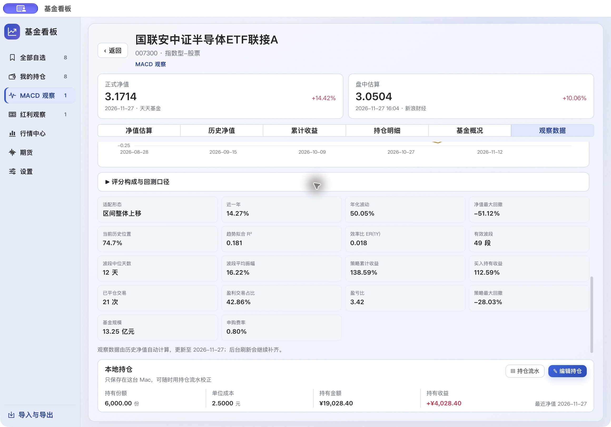

展开「评分构成与回测口径」后，可以核对完整指标。示例中适配形态为「区间整体上移」，近一年收益 14.27%、年化波动 50.05%、净值最大回撤 -51.12%、当前历史位置 74.7%、趋势拟合 R² 0.181、效率比 ER(1Y) 0.018；另有有效波段 49 段、波段中位天数 12 天、波段平均振幅 16.22%，以及策略累计收益、买入持有收益、已平仓交易、盈利交易占比、盈亏比、策略最大回撤、基金规模和申购费率。切换图表显示区间只影响图形，评分仍使用同一批完整样本。

### 红利观察

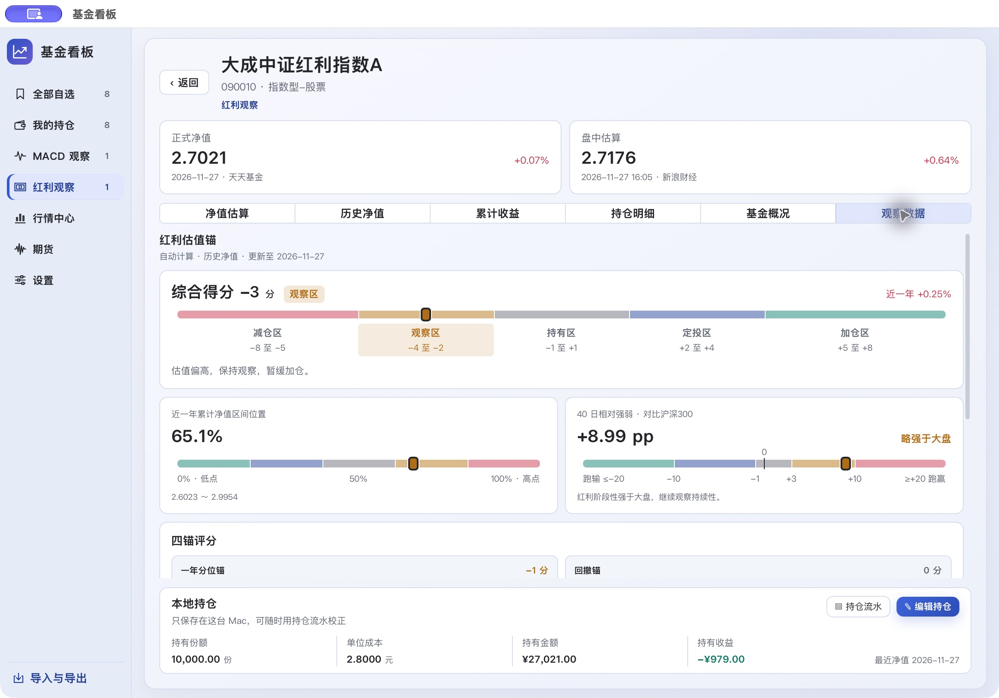

红利观察先给出综合得分和所处区间。示例为 -3 分、观察区，操作提示为「估值偏高，保持观察，暂缓加仓」。综合得分范围为 -8 至 +8，从左到右分为减仓区、观察区、持有区、定投区和加仓区。

- **近一年累计净值区间位置**：当前净值在最近一年最低点到最高点之间的位置。示例为 65.1%，卡片下方给出区间净值 2.6023～2.9954；百分比越高，说明越接近近一年高位。
- **40 日相对强弱**：基金近 40 个交易日相对沪深 300 的超额表现。示例为 +8.99 个百分点，标签为「略强于大盘」；零为基准，左侧跑输、右侧跑赢。

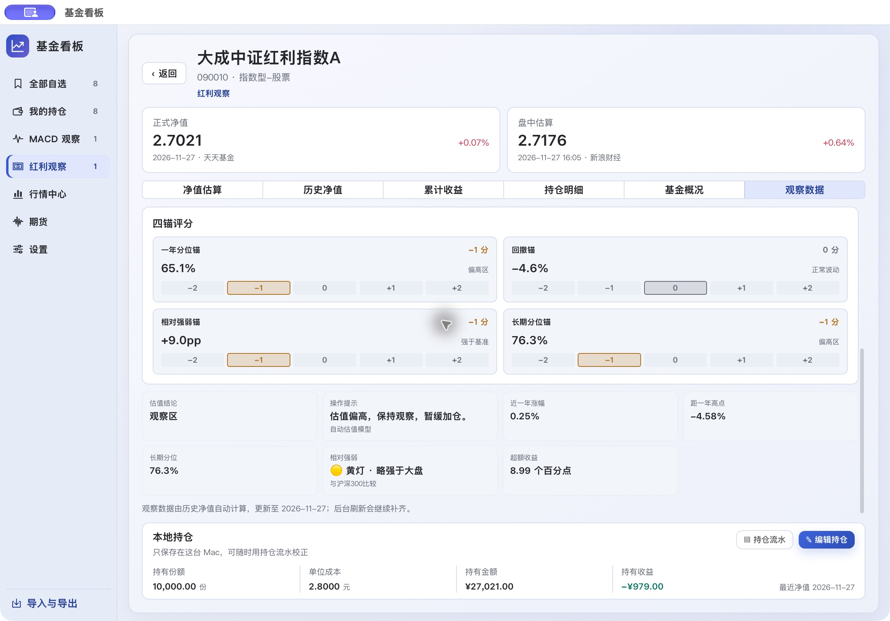

四锚各按 -2 至 +2 计分，合成为综合得分：

| 估值锚 | 观察内容 | 示例 |
| --- | --- | --- |
| 一年分位锚 | 近一年累计净值分位；低于 20% 为低位，高于 80% 为高位 | 65.1%，偏高区，-1 分 |
| 回撤锚 | 当前净值距一年高点的回撤；回撤较深时加分 | -4.6%，正常波动，0 分 |
| 相对强弱锚 | 近 40 个交易日相对沪深 300；弱于基准加分，强于基准减分 | +9.0 个百分点，强于基准，-1 分 |
| 长期分位锚 | 按可用历史区间计算分位，最多 600 个交易日 | 76.3%，偏高区，-1 分 |

示例的四个单项为 -1、0、-1、-1，合计 -3 分，因此落在观察区。下方同时给出估值结论、操作提示、近一年涨幅、距一年高点、长期分位、相对强弱灯号和超额收益。红利估值锚使用的是价格分位、回撤和相对强弱代理指标，未接入股息率、PE、PB 或股债利差，不能替代完整的基本面估值。

如果东方财富历史净值或沪深300日线暂时不可用，应用会保留上次自动计算结果，并在恢复后继续更新。分组只是整理自选基金的一种方式。把基金加入或移出分组不会改变持仓，也不会触发交易。

## 7. 行情中心

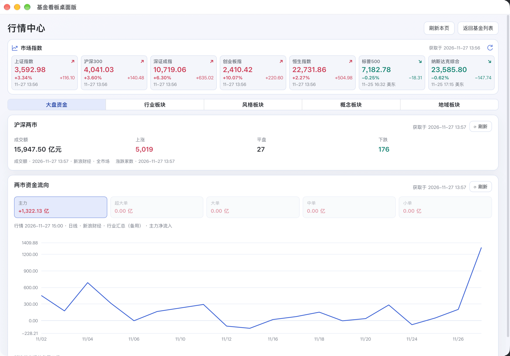

行情中心包含：

- 7 个市场指数卡片：上证指数、沪深 300、深证成指、创业板指、恒生指数、标普 500、纳斯达克综合。
- 点击指数卡片查看分时。价格和成交量按当地交易时段映射，午间休市压缩为一个刻度。
- 从基金看板的指数卡片进入分时，点左上角返回会回到原来的基金分组。从行情中心打开分时，返回会回到行情分类。
- 大盘资金、行业板块、风格板块、概念板块、地域板块五个分类。
- 成交额、上涨/平盘/下跌家数和资金流。

「刷新本页」会同时刷新当前指数卡和当前分时或分类；指数卡右上角的刷新按钮只刷新指数。

东方财富接口不可用时，涨跌家数会切换到新浪全市场快照，资金流会切换到新浪行业汇总。界面会标注「备用」和实际口径；备用源只有主力口径时，不会显示超大类、大单、中单、小单的拆分。

## 8. 期货

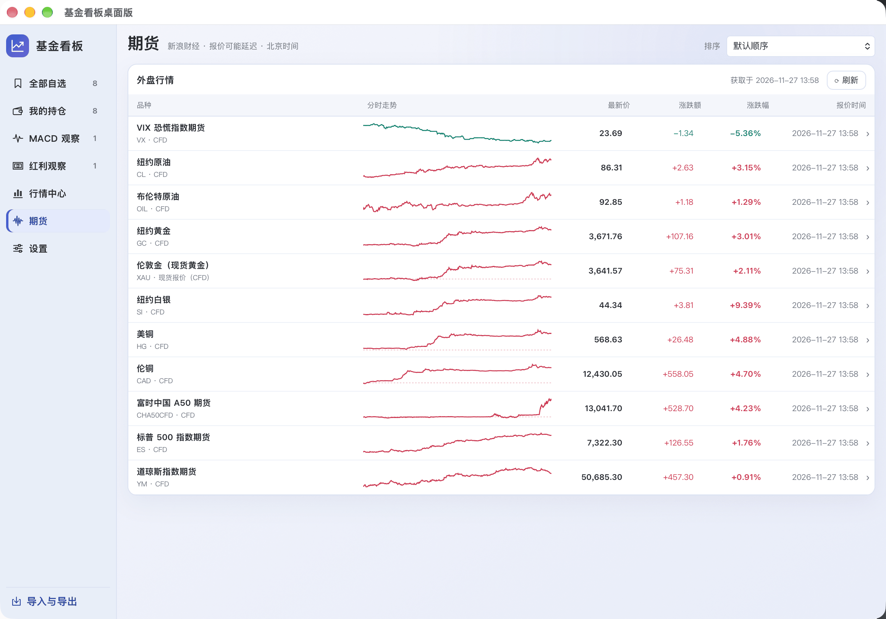

期货页默认显示新浪财经提供的外盘品种，包括 VIX、原油、黄金、白银、铜、A50、标普 500 和道琼斯指数期货等。

- 点击「添加自选」可按名称、代码或拼音模糊搜索外盘期货，点击搜索结果中的「添加」确认加入；已加入的品种会标为「已添加」，自选品种可随时移除。自选列表保存在数据目录的 `futures-watchlist.json`。
- 报价可能延迟，页面顶部会标注数据源和北京时间。
- 点击品种查看分时和日线。样本达到 35 个时，详情会显示 MACD 和 DIF/DEA 读数。

期货行情只用于观察，不提供交易下单。

## 9. 设置

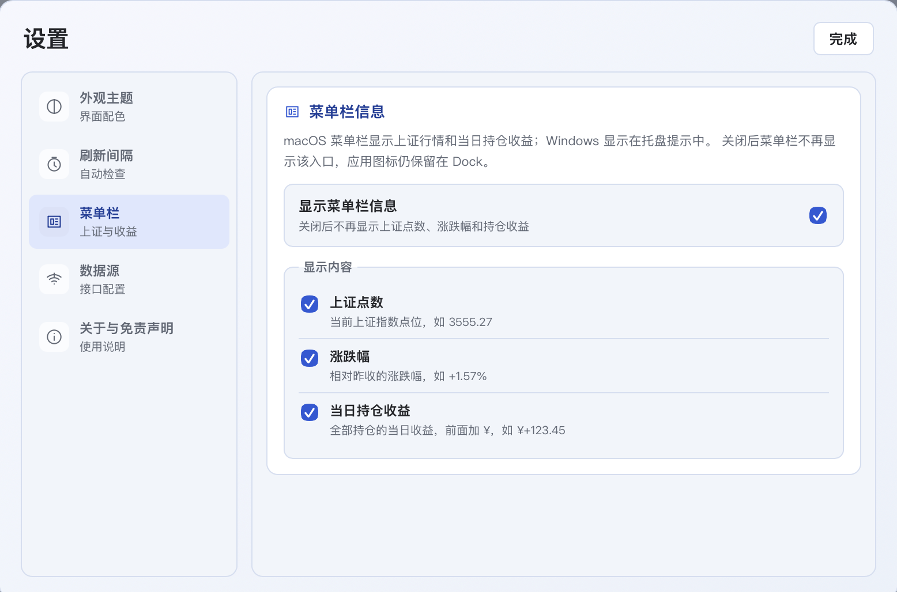

设置采用左右分栏：左侧选择配置分类，右侧显示对应内容；后续新增配置项可直接加入左侧分类。

- **外观主题**：跟随系统、白色、黑色。
- **刷新间隔**：5 秒、10 秒、30 秒、60 秒，默认 10 秒，并显示当前刷新策略。
- **菜单栏**：开关是否显示菜单栏信息，并复选上证点数、涨跌幅、当日持仓收益；持仓收益自动带 `¥` 前缀。
- **数据源**：查看当前配置状态、打开数据源配置窗口，或一键恢复内置默认配置。
- **加入社群**：用微信扫一扫添加好友，或复制微信号 `jzq301`，在微信「添加朋友」中搜索。进群后可以反馈使用问题、提出功能建议，也能及时了解版本更新。
- **支持开发**：查看支付宝、微信赞赏码。赞赏完全自愿，不解锁功能，也不经过应用后端。
- **关于**：查看当前版本、手动检查更新和下载安装。应用运行时每 24 小时自动检查，发现新版本后可点击看板右上角的「有新版本」直接进入。
- **免责声明**：查看软件用途、数据来源与风险说明。

刷新策略：

- 盘中估值按所选间隔检查，只在交易时段内生效。
- 正式净值继续使用缓存周期，避免重复下载历史数据；手动刷新会立即检查。
- 刷新进行中不会重复发起请求；请求失败会退避重试，并保留上一次成功的数据。

如果网络较慢或数据源限流，建议改为 30 秒或 60 秒。

## 10. 批量导入持仓

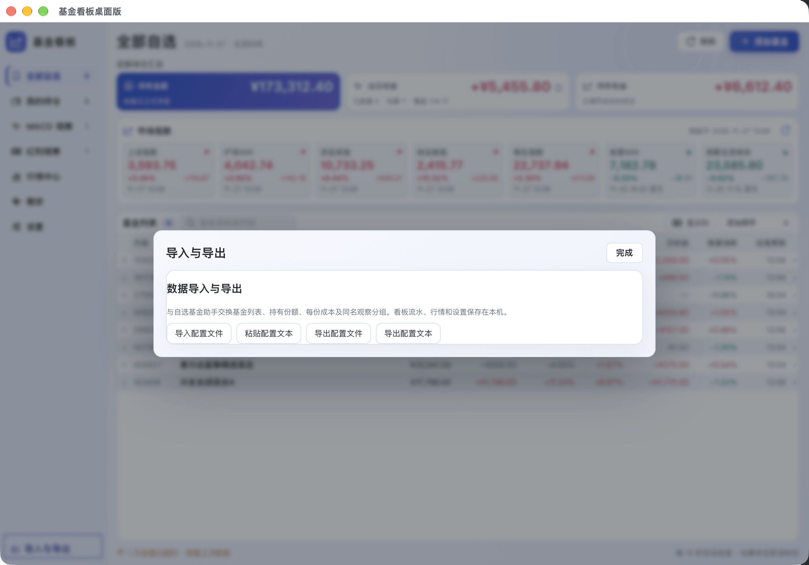

点击左下角「使用向导」，可查看三步图示，再点「前往批量导入持仓」直接打开导入页。也可以通过「设置 → 批量导入持仓」进入。

1. 在支付宝、天天基金等 App 打开基金持仓详情，截下持有份额和成本单价。在使用向导或导入页点击「下载 AI 导入模板」，将模板提示词和截图一起交给豆包等 AI 生成表格。
2. 将 AI 生成的表格贴到「粘贴持仓文本」并点击「预览持仓」，或保存成 UTF-8 的 TSV/TXT 文件，通过「导入持仓文件」打开。
3. 对照截图核对基金代码（含前导零）、份额和每份成本。缺失字段可以填 `-`，每只基金至少提供份额或成本中的一项。重复代码会提示行号，修正后可重新预览。
4. 确认后导入。已有基金默认只补齐空白字段。需要更新已有值时，可勾选覆盖，表格中的空白字段仍会跳过。同一基金分布在多个平台时，请先核实合并后的总份额和每份成本。

## 11. 菜单栏与托盘

### macOS

- 默认显示「上证」、当前点数和涨跌幅；可在「设置 → 菜单栏」中开关，并复选上证点数、涨跌幅、当日持仓收益。
- 只勾选当日持仓收益时，前缀显示为「持仓」；金额前自动加 `¥`，例如 `¥+123.45`。
- 各数字按自身涨跌或收益方向着色：上涨为红色，下跌为绿色，平盘使用系统文字颜色。
- 关闭「显示菜单栏信息」后，菜单栏不再显示该入口；应用图标仍保留在 Dock。
- 点击菜单栏区域打开看板。
- 关闭主窗口后应用继续驻留；点击 Dock 图标或菜单栏可重新显示。
- 托盘菜单提供「打开看板」「刷新行情」「退出」。

上证行情约每分钟刷新一次；当日持仓收益随看板刷新（默认 10 秒）。

### Windows

- 托盘图标提供相同的「打开看板」「刷新行情」「退出」菜单。
- 「设置 → 菜单栏」中的显示项会作用于托盘提示文本；关闭后托盘图标仍保留，提示恢复为应用名称。
- 关闭主窗口后默认隐藏到托盘，需要退出时使用托盘菜单。

## 12. 数据目录、备份与迁移

默认数据目录：

| 系统 | 路径 |
| --- | --- |
| macOS | `~/Library/Application Support/FundDeskDesktop` |
| Windows | `%APPDATA%\FundDeskDesktop` |

可以用环境变量 `FUND_DESK_DATA_DIR` 指向其他目录，适合演示、测试或把数据放在移动硬盘：

```sh
FUND_DESK_DATA_DIR="$PWD/.demo-data" pnpm tauri dev
```

目录中的主要文件：

| 文件 | 内容 |
| --- | --- |
| `board.json` | 自选、持仓、快照、观察数据、列顺序和设置 |
| `board.backup.json` | 上一次成功保存的看板，用于损坏时回退 |
| `catalog.json` | 本地基金目录缓存 |
| `data-sources.json` | 数据源地址；不含行情数据 |
| `research-v1/` | 基金档案、披露、经理等研究缓存 |
| `futures-watchlist.json` | 期货自选 |
| `trace.log` | 排障日志，可能包含本机路径 |

备份：

1. 退出应用。
2. 复制整个数据目录到安全位置。
3. 恢复时先退出应用，再用备份目录替换当前目录。

迁移到另一台电脑：

- 迁移时可在退出应用后复制整个数据目录。
- 不要在两台机器同时修改同一份云盘目录，避免 `board.json` 互相覆盖。
- 卸载应用不会自动删除数据目录；需要彻底清理时手动删除。

## 13. 常见问题

**为什么有的基金没有盘中估算？**

QDII、海外基金、货币基金、估值基准日不一致或数据源未覆盖时，可能没有估算。应用会显示「数据源未提供」或保留最近一次正式净值，不会用其他基金的数据代替。

**启动后没有指数、净值或估算？**

先检查顶部是否提示「尚未配置数据源」。打开「设置 → 数据源」，点击「恢复内置默认」或导入自己的 `data-sources.json` 并保存；如果只配置了部分地址，提示会列出缺少的字段。

**当日收益为什么和基金公司或交易平台不一样？**

当日收益是看板按「正式净值优先、盘中估算补充」计算的参考值。QDII 净值披露有延迟，货币基金的收益口径不同，分红、申购确认和赎回费也可能造成差异。以基金公司或销售机构的对账单为准。

**为什么出现「估值已过期 · 保留上次数据」？**

缓存估值日期或时间超过有效范围。应用继续保留最近可用的数据。休市日会直接显示休市原因。

**macOS 提示应用已损坏或无法验证开发者？**

当前包是 ad-hoc 签名、未公证的构建。请在「系统设置 → 隐私与安全性」选择「仍要打开」，并先核对 SHA-256。如果仍然不放心，可以从源码自行构建。

**Windows 提示 SmartScreen 拦截？**

安装包没有 Authenticode 签名。确认下载来源和 SHA-256 后，选择「更多信息 → 仍要运行」。不要运行来源不明的安装包。

**关闭窗口后应用还在运行？**

这是桌面端的常驻设计，用于继续刷新菜单栏和托盘报价。macOS 从托盘菜单或 Dock 退出，Windows 从托盘菜单退出。

**数据会上传到服务器吗？**

不会。应用没有账号系统、没有自建服务端，也没有统计或遥测上报。自选、持仓和设置只写入本机数据目录；网络请求仅用于获取公开行情、净值、披露和研究资料。

**可以从源码构建吗？**

可以。需要 Node.js 20+、pnpm 和 Rust stable；macOS 还需要 Xcode Command Line Tools。开发命令见根目录 `README.md`。

## 14. 隐私与免责声明

- 本应用仅供学习和研究使用，是本地工具，不提供投资顾问、荐股、代客理财或交易服务。
- 所有净值、估值、指数、板块、资金流和期货数据均来自第三方公开接口，可能存在延迟、缺失、口径差异或错误。本应用不对数据的准确性、完整性和及时性作出保证，亦不承担因使用这些数据而产生的责任。
- MACD 评分、红利评分、推荐语和买卖点仅用于研究记录，不构成任何投资建议或操作依据。据此操作，风险自担。
- 数据接口可能随时变更或停止服务。应用会尽量回退到备用源，但不保证始终可用。
- 请以基金公司、交易所等官方披露为准，谨慎参考。应用内可在自选看板底部及「设置 → 免责声明」查看本说明。
- 使用本软件即表示你理解并接受上述限制。详见 [数据来源与开源合规](数据来源与开源合规.md)。
