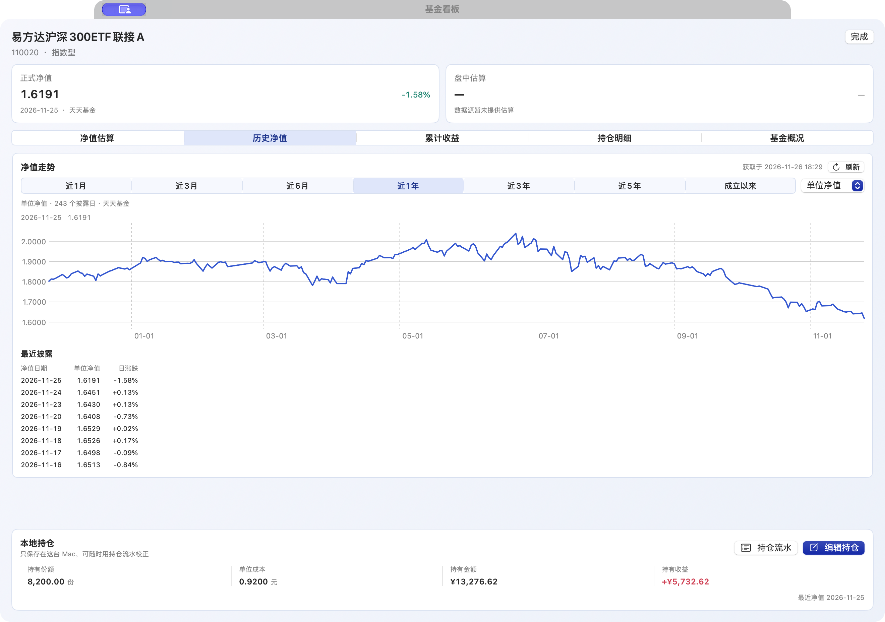

# 基金看板使用指南

## 安装和更新

### macOS

1. 从 [GitHub Releases](https://github.com/JazZ301/FundDesk/releases/latest) 下载 `FundDesk-0.3.28-macOS-arm64.dmg`。此包适用于 Apple 芯片和 macOS 13 或更新版本。
2. 打开 DMG，将「基金看板」拖入「应用程序」。更新时，先退出已打开的基金看板，再替换旧版本。
3. 在「应用程序」中双击「基金看板」。当前版本使用临时签名，未经过 Apple 公证。如果 macOS 提示无法验证开发者，请先核对下载来源和 Release 中的 SHA-256。确定信任此包后，可从「系统设置 → 隐私与安全性」为此应用选择「仍要打开」。

### Chrome

1. 从 [GitHub Releases](https://github.com/JazZ301/FundDesk/releases/latest) 下载 `FundDesk-Chrome-0.1.0.zip`，解压到长期保留的位置。
2. 在 Chrome 130 或更新版本中打开 `chrome://extensions`，启用「开发者模式」，点「加载已解压的扩展程序」，选择刚解压的 `ChromeExtension` 目录。
3. 在 Chrome 的扩展菜单中将「基金看板」固定到工具栏。点图标可查看上证指数，点「打开完整看板」进入主界面。
4. 更新前导出 JSON 备份。将新文件解压到原来的安装目录后，在扩展页点击「重新加载」。迁移到另一个目录或 Chrome 配置文件后，可从备份恢复。

## 自选、持仓与流水

- 用「添加基金」搜索基金。只想跟踪时，保留自选即可。已有仓位时，在基金详情填写持有份额和每份成本，再保存。macOS 可用 `⌘N` 添加基金、`⌘F` 搜索当前自选、`⌘R` 刷新。
- 后续申购、赎回或分红，可打开「持仓流水」录入日期、份额、成交净值及适用的费用。修改流水会重算相关持仓。
- 主看板展示已录入持仓的总额、收益和当日变动。查看「当日收益」时，留意数据日期和覆盖范围。盘中参考估值与晚间披露的正式净值可能不同。
- 打开基金详情可查看净值、收益走势和披露持仓等信息。图表和指标的可用范围取决于基金类型与数据来源。

## 指数与期货

点击主页的指数卡片可查看对应走势。macOS 的「行情中心」包含市场指数和其他市场指标，「期货」可查看可用合约报价。Chrome 完整看板提供相应行情入口。第三方数据源可能延迟或暂时不可用，请结合页面显示的时间和行情状态查看。

## 数据、备份与迁移

| 操作 | 适用场景 |
| --- | --- |
| 完整 JSON 备份 | 迁移到另一设备，或保留自选、持仓、流水、设置及备份所含的行情和观察数据 |
| 轻量 JSON 备份 | 迁移自选、持仓、流水和设置，历史基金行情可在恢复后重新获取 |
| CSV 导出 / 合并导入 | 交换自选和持仓列表。macOS 会先显示导入预览并跳过重复记录 |
| 从备份恢复 | 以选中的备份替换当前看板。确认前查看预览，恢复时会保留恢复点 |

macOS 从侧栏打开「备份与恢复」，Chrome 从「设置 → 备份与恢复」进入。跨版本迁移建议使用完整 JSON。当前 macOS 版与 Chrome 扩展支持手动导入和导出 v4 完整备份。

macOS 默认把应用数据保存在 `~/Library/Application Support/FundDesk`，Chrome 把数据保存在当前浏览器配置文件的扩展存储中。行情由应用或扩展直接向第三方数据源请求。备份文件可能包含你的实际份额、成本及流水，请妥善保管。

## 截图说明

文档中的基金名称和代码来自公开市场。截图所用仓位、成本以及据此计算的金额和收益仅供演示。
